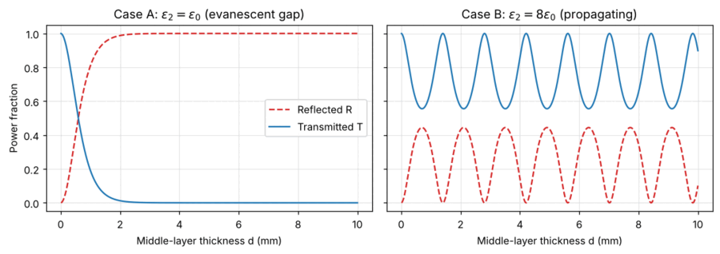
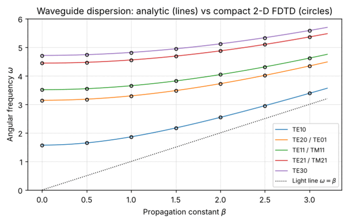
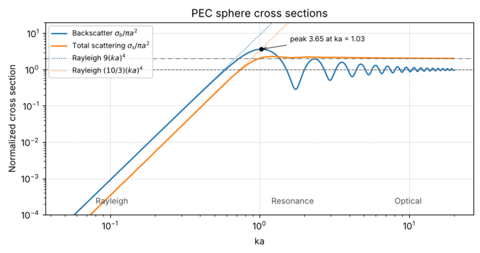

# RF and Antenna Tutorials

[](https://github.com/jman4162/RF-and-Antenna-Tutorials/actions/workflows/notebooks.yml)

Worked problems in RF engineering, antennas and applied electromagnetics, written as Jupyter notebooks that derive the physics, implement it in plain NumPy/SciPy, and plot the results. Each notebook opens in Google Colab with one click, and CI executes every notebook on pushes to main, on pull requests, and once a month.

The electromagnetics notebooks check their results with `assert` statements against closed-form solutions (Fresnel equations, discrete dispersion relations, the optical theorem, Rayleigh and optical limits), so a wrong result fails the build. Several of them are modern, tested versions of graduate projects from Virginia Tech; the original MATLAB is in [electromagnetics-work-samples](https://github.com/jman4162/electromagnetics-work-samples).

## Notebooks

### Electromagnetic waves and numerical methods

| Notebook | What it covers | |
|---|---|---|
| [Plane waves in multilayer media: the transfer-matrix method](Multilayer_Media_Transfer_Matrix_Method_Tutorial.ipynb) | Fresnel coefficients, Brewster angle and total internal reflection; transfer matrices; antireflection coatings and Bragg mirrors; frustrated TIR and Fabry–Pérot resonances in a three-layer stack; guided TM modes of an asymmetric slab waveguide | [](https://colab.research.google.com/github/jman4162/RF-and-Antenna-Tutorials/blob/main/Multilayer_Media_Transfer_Matrix_Method_Tutorial.ipynb) |
| [FDTD from scratch: a 1-D cavity and a 2-D waveguide](FDTD_From_Scratch_Cavity_and_Waveguide_Tutorial.ipynb) | Yee grid and leapfrog time stepping; the Courant limit; numerical dispersion and second-order convergence; compact 2-D FDTD for the full dispersion diagram of a rectangular waveguide | [](https://colab.research.google.com/github/jman4162/RF-and-Antenna-Tutorials/blob/main/FDTD_From_Scratch_Cavity_and_Waveguide_Tutorial.ipynb) |
| [Scattering from a conducting sphere: the Mie series](Scattering_From_a_Conducting_Sphere_Mie_Series_Tutorial.ipynb) | Plane-wave expansion in vector spherical harmonics; PEC Mie coefficients; scattering, extinction and backscatter cross sections; the sphere RCS curve; bistatic patterns; near-field maps | [](https://colab.research.google.com/github/jman4162/RF-and-Antenna-Tutorials/blob/main/Scattering_From_a_Conducting_Sphere_Mie_Series_Tutorial.ipynb) |

| Frustrated TIR and Fabry–Pérot resonances | Waveguide dispersion from compact 2-D FDTD | Radar cross section of a PEC sphere |
|:---:|:---:|:---:|
|  |  |  |

### Antennas and links

| Notebook | What it covers | |
|---|---|---|
| [Simulation of dipole antennas in Python](Simulation_of_Dipole_Antennas_in_Python_Modeling_and_Visualization_Tutorial.ipynb) | Current distribution, radiation pattern, impedance and bandwidth of dipoles, with pattern plots | [](https://colab.research.google.com/github/jman4162/RF-and-Antenna-Tutorials/blob/main/Simulation_of_Dipole_Antennas_in_Python_Modeling_and_Visualization_Tutorial.ipynb) |
| [A practical tutorial on monopole antennas](A_Practical_Tutorial_on_Monopole_Antennas.ipynb) | Resonant length, image theory, input impedance, radiation pattern and gain | [](https://colab.research.google.com/github/jman4162/RF-and-Antenna-Tutorials/blob/main/A_Practical_Tutorial_on_Monopole_Antennas.ipynb) |
| [Deriving the G/T requirement for satellite communications](Python_Tutorial_Deriving_G_T_Requirement_for_Satellite_Communications.ipynb) | Antenna gain, system noise temperature, and a step-by-step G/T link-budget derivation | [](https://colab.research.google.com/github/jman4162/RF-and-Antenna-Tutorials/blob/main/Python_Tutorial_Deriving_G_T_Requirement_for_Satellite_Communications.ipynb) |

## Running locally

```bash
pip install -r requirements.txt
jupyter lab
```

To execute every notebook the way CI does:

```bash
pip install -r requirements.txt pytest nbmake
pytest --nbmake *.ipynb
```

## Related projects

- [OpenEM Wave Lab](https://jman4162.github.io/openem-wave-lab/): interactive browser lessons on electromagnetic wave physics ([source](https://github.com/jman4162/openem-wave-lab))
- [Phased-Array-Antenna-Model](https://github.com/jman4162/Phased-Array-Antenna-Model): array-factor computation, beamforming and 3-D pattern visualization
- [phased-array-systems](https://github.com/jman4162/phased-array-systems): system-level phased-array design and trade studies
- [metasurface-py](https://github.com/jman4162/metasurface-py): programmable metasurface design and optimization
- [electromagnetics-work-samples](https://github.com/jman4162/electromagnetics-work-samples): graduate EM projects, PhD metasurface research and industry talks
- [john-hodge.com](https://john-hodge.com/): author's site

## License

MIT. See [LICENSE](LICENSE).
